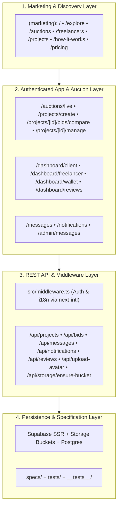

# Naafs (`naafs`) — Live Reverse-Auction & Freelance Bidding Marketplace

A full-stack Next.js 16 (`nafis-app`), React 19, `next-intl`, and Supabase marketplace built around **live reverse-auctions** and competitive project bidding, complete with side-by-side bid comparison, dual Client/Freelancer dashboards, an internal wallet, and real-time messaging.

---

## 1. Executive Summary & Purpose
`naafs` turns project outsourcing into an interactive, transparent bidding experience. Clients post projects (`/projects/create`), watch competitive proposals arrive in real time (`/auctions/live`), compare bids side-by-side (`/projects/[id]/bids/compare`), and manage contracts, wallets, and reviews across dedicated Client and Freelancer dashboards.

---

## 2. System Architecture & Layers



| Layer | Responsibility | Key Files |
| :--- | :--- | :--- |
| **Marketing & Acquisition Layer** | Public marketplace discovery, pricing, and how-it-works funnels | `src/app/(marketing)/{page,explore,auctions,freelancers,projects,pricing,how-it-works}/page.tsx` |
| **Live Auction & Bidding Layer** | Real-time auction room, bid submission, and `BidSelectionList` comparison engine | `src/app/(app)/auctions/live/page.tsx`, `src/app/(app)/projects/[id]/bids/compare/page.tsx`, `src/components/bidding/BidSelectionList.tsx` |
| **Role Dashboards & Wallet Layer** | Separate Client and Freelancer operational views, wallet ledger, and review management | `src/app/(app)/dashboard/{client,freelancer,wallet,reviews,settings}/page.tsx` |
| **REST API & Storage Layer** | CRUD endpoints for projects, bids, messages (with mark-read), notifications, reviews, and Supabase Storage buckets | `src/app/api/{bids,projects,messages,notifications,reviews,upload-avatar,storage/ensure-bucket}/route.ts` |
| **Auth & Governance Layer** | Role onboarding (`/onboarding/role`), route middleware, and admin messaging oversight | `src/app/(auth)/onboarding/role/page.tsx`, `src/middleware.ts`, `src/app/(app)/admin/messages/page.tsx` |

---

## 3. Core Functionality & Modules
- **Live Auctions (`/auctions/live`)**: Real-time competitive bidding environment where freelancers submit bids and clients evaluate offers dynamically.
- **Bid Comparison Engine (`/projects/[id]/bids/compare`)**: Structured side-by-side comparison of price, timeline, and freelancer ratings.
- **Dual-Persona Experience**: Role selection during onboarding (`(auth)/onboarding/role`) routes users to tailored `/dashboard/client` or `/dashboard/freelancer` workflows.
- **Wallet & Reviews (`/dashboard/wallet`, `/dashboard/reviews`)**: Balance/payout tracking and post-completion reputation scoring.
- **Messaging & Notifications**: Stateful read/unread tracking via `/api/messages/[id]/mark-read` and `/api/notifications/[id]/mark-read`.

---

## 4. Project Structure
```text
├── src/
│   ├── app/
│   │   ├── (app)/        # auctions/live, dashboard/*, projects/*, freelancers/[id], messages, admin/messages
│   │   ├── (auth)/       # login, register, onboarding/role, password recovery
│   │   ├── (marketing)/  # Public landing, explore, auctions, freelancers, pricing
│   │   └── api/          # bids, projects, messages, notifications, reviews, storage, upload-avatar
│   ├── components/       # bidding/BidSelectionList & UI primitives
│   ├── lib/ & types/     # Shared utilities & TypeScript contracts
│   └── middleware.ts     # Session & localization middleware
├── supabase/             # Database schema & RLS policies
├── specs/                # Feature specifications
└── tests/ & __tests__/   # Automated test suites
```

---

## 5. Getting Started

```bash
git clone https://github.com/islamsamyy/naafs.git
cd naafs
npm install
cp .env.example .env.local
npm run dev
```

---

## 6. Business Value & Growth Opportunities
- **Take-Rate Marketplace Economics**: Capture a 10–15% commission on every awarded project settled through `/dashboard/wallet`, plus promoted listing fees for urgent client auctions.
- **Escrow Milestone Integration**: Connect `/dashboard/wallet` to Stripe Connect / HyperPay / Paymob to automate milestone holds and releases.
- **AI Scope & Fair-Price Estimator**: Pre-populate `/projects/create` budgets using historical winning bids so clients attract higher-quality proposals faster.
- **Enterprise Procurement Mode**: Let corporate clients invite pre-vetted vendor pools to private reverse auctions for B2B contracts.
