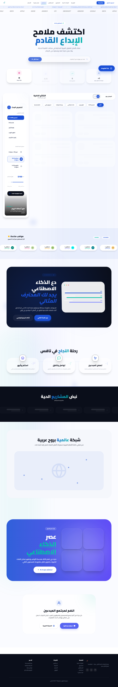
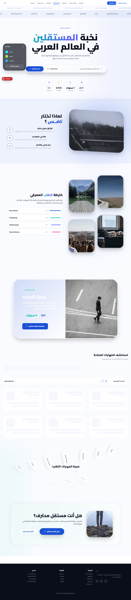
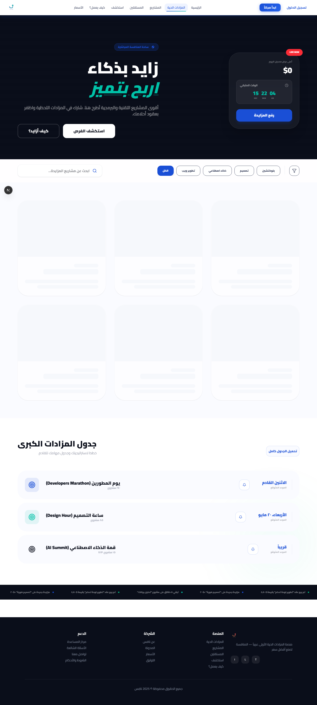
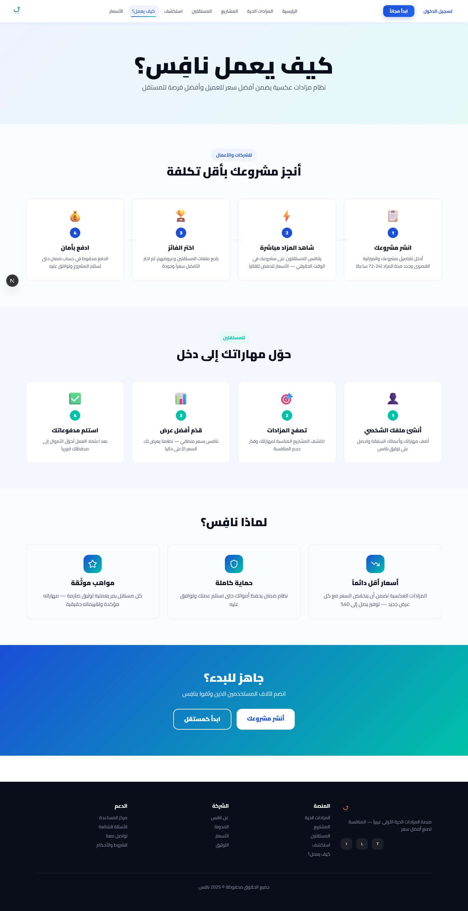
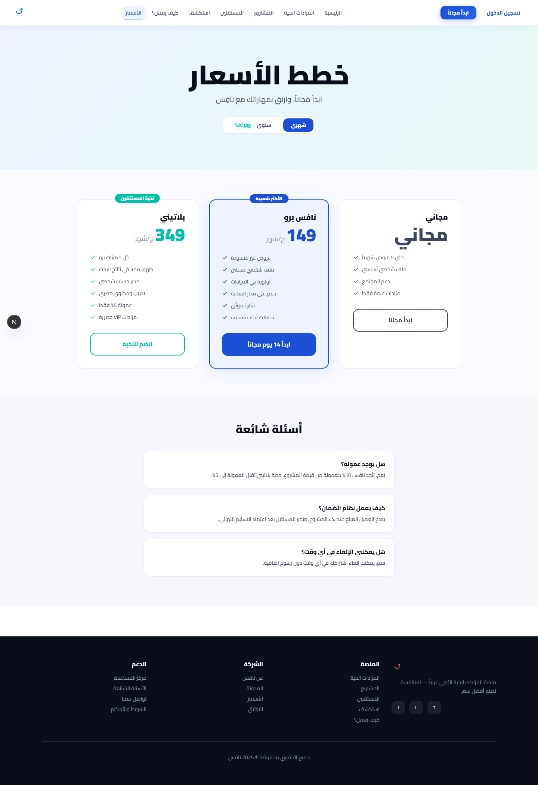
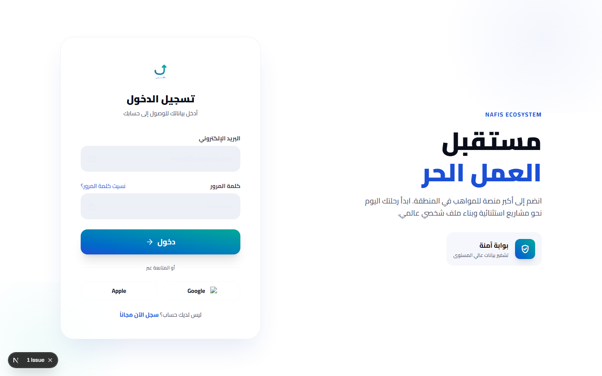
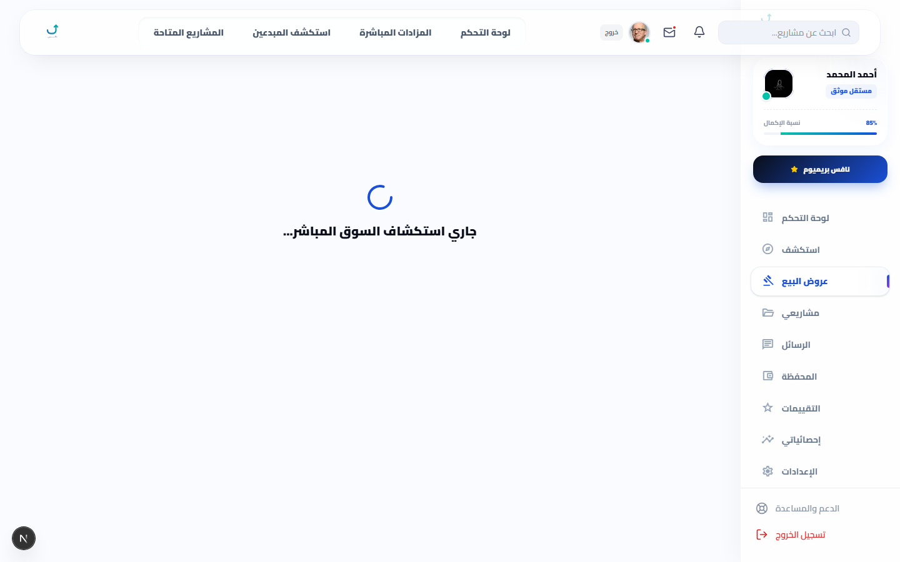
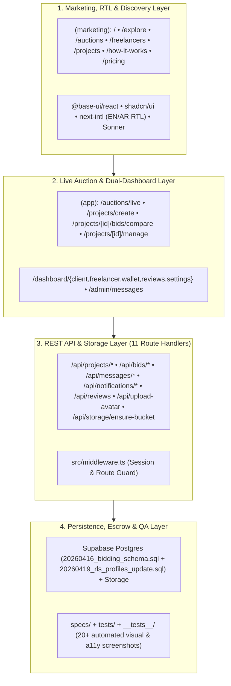
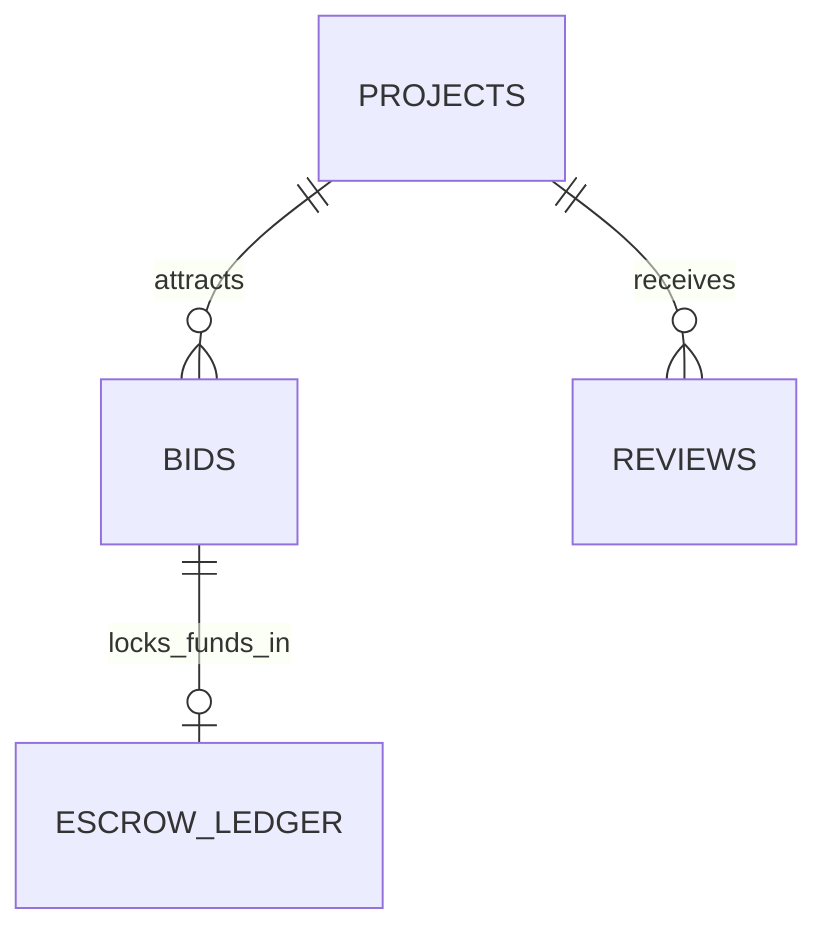

# Naafs (`naafs`) — Live Reverse-Auction & Freelance Bidding Marketplace

<p align="center">
  
</p>

## Table of Contents
- [Executive Summary & Business Utility](#executive-summary--business-utility)
- [Visual Showcase (UI & Dashboards)](#visual-showcase-ui--dashboards)
- [System Architecture & Layers](#system-architecture--layers)
- [Data Model & Escrow Mechanics](#data-model--escrow-mechanics)
- [Database Schema, Migrations & RLS](#database-schema-migrations--rls)
- [Application Modules & API Endpoints](#application-modules--api-endpoints)
- [Getting Started & Scripts](#getting-started--scripts)
- [Business Value, ROI & Growth Opportunities](#business-value-roi--growth-opportunities)

---

## Executive Summary & Business Utility
`naafs` (`nafis-app`) is an internationalized Next.js 16, React 19, `next-intl`, and Supabase freelance marketplace built around **live reverse-auctions** and competitive bidding. Clients publish project briefs (`/projects/create`), watch real-time competitive bids arrive (`/auctions/live`), evaluate proposals side-by-side (`/projects/[id]/bids/compare`), and release funds through an audited **escrow ledger** (`escrow_ledger`) across dedicated Client and Freelancer dashboards.

---

## Visual Showcase (UI & Dashboards)
Verified desktop & responsive UI screenshots from `tests/screenshots/` and `public/images/`:

| Landing Hero | Explore Marketplace | Freelancers Directory |
| :---: | :---: | :---: |
|  |  |  |

| Live Reverse Auctions | How It Works | Pricing & Tiers |
| :---: | :---: | :---: |
|  |  |  |

| RTL Login Support | Responsive Mobile (375px) | Live Auction Room |
| :---: | :---: | :---: |
|  |  |  |

---

## System Architecture & Layers



| Layer | Responsibility | Key Files |
| :--- | :--- | :--- |
| **Marketing & RTL Layer** | Bilingual discovery pages, pricing, and responsive desktop/tablet/mobile layouts | `src/app/(marketing)/*`, `tests/screenshots/*` |
| **Live Bidding & Comparison Layer** | Real-time reverse auctions and `BidSelectionList.tsx` side-by-side proposal evaluator | `src/app/(app)/auctions/live/page.tsx`, `src/app/(app)/projects/[id]/bids/compare/page.tsx`, `src/components/bidding/BidSelectionList.tsx` |
| **Role Dashboards & Wallet** | Role onboarding (`/onboarding/role`), Client & Freelancer cockpits, escrow wallet, and reviews | `src/app/(app)/dashboard/{client,freelancer,wallet,reviews,settings}/page.tsx` |
| **REST API & Storage Layer** | 11 route handlers for bidding, messaging read-receipts, notifications, reviews, and avatar uploads | `src/app/api/{bids,projects,messages,notifications,reviews,upload-avatar,storage/ensure-bucket}/**` |
| **Schema, RLS & Spec Layer** | Bidding/escrow SQL migrations, RLS profile policies, specs, and visual/a11y tests | `supabase/migrations/*.sql`, `specs/`, `tests/`, `__tests__/` |

---

## Data Model & Escrow Mechanics


---

## Database Schema, Migrations & RLS
Defined in `supabase/migrations/20260416_bidding_schema.sql` and `20260419_rls_profiles_update.sql`:
- `public.bids` — Freelancer proposals (price, timeline, pitch, selection status) linked to projects
- `public.escrow_ledger` — Financial ledger tracking held, released, and refunded milestone funds
- Profile RLS policies ensuring users can only mutate their own records

---

## Application Modules & API Endpoints

| Endpoint | Purpose |
| :--- | :--- |
| `/api/projects` & `/api/projects/[id]` | Project creation, listing & detail operations |
| `/api/bids` & `/api/bids/[id]` | Submit, update, and accept/reject competitive bids |
| `/api/messages` & `/api/messages/[id]/mark-read` | Client-freelancer messaging with read state |
| `/api/notifications` & `/api/notifications/[id]/mark-read` | Real-time alerts & read tracking |
| `/api/reviews` | Verified post-project reviews |
| `/api/upload-avatar` & `/api/storage/ensure-bucket` | Supabase Storage bucket provisioning & avatar uploads |

---

## Getting Started & Scripts

```bash
git clone https://github.com/islamsamyy/naafs.git
cd naafs
npm install
cp .env.example .env.local
npm run dev
```

---

## Business Value, ROI & Growth Opportunities
- **Reverse-Auction Price Discovery**: Drives transparent competition among vetted freelancers while protecting quality through side-by-side comparison (`/bids/compare`) and reviews.
- **Escrow Commission Engine**: `escrow_ledger` is ready to support a 10–15% marketplace take-rate plus featured auction boosts.
- **Regional Payment Integration**: Wire `escrow_ledger` to Moyasar/HyperPay/Stripe Connect for automated payouts across Saudi Arabia and MENA.
